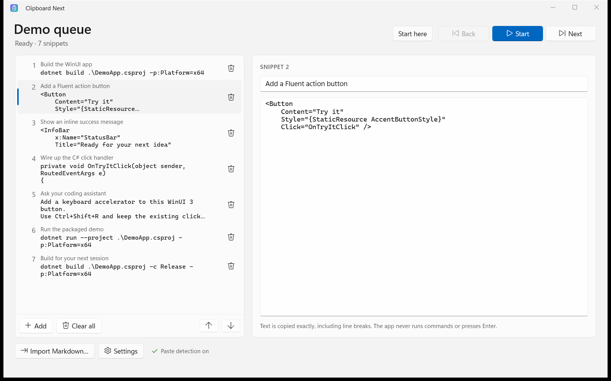
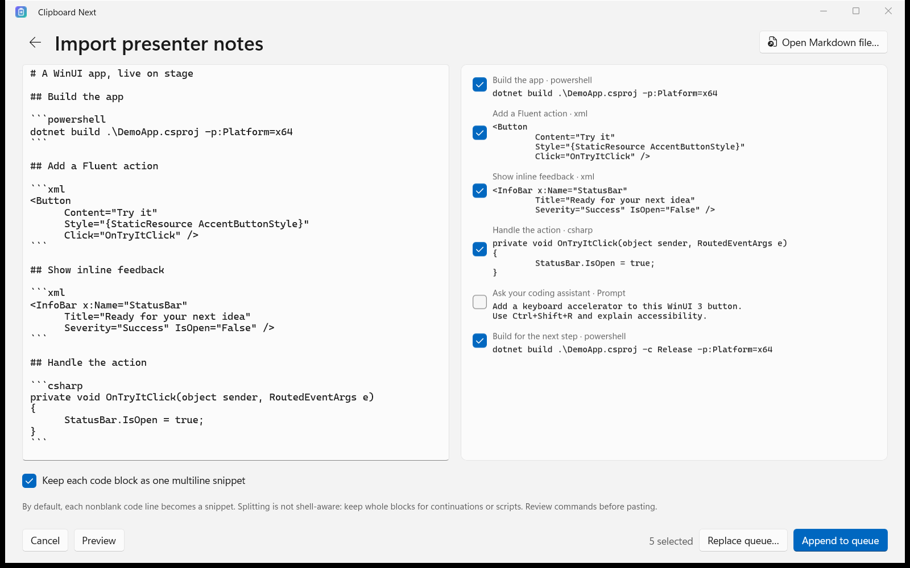
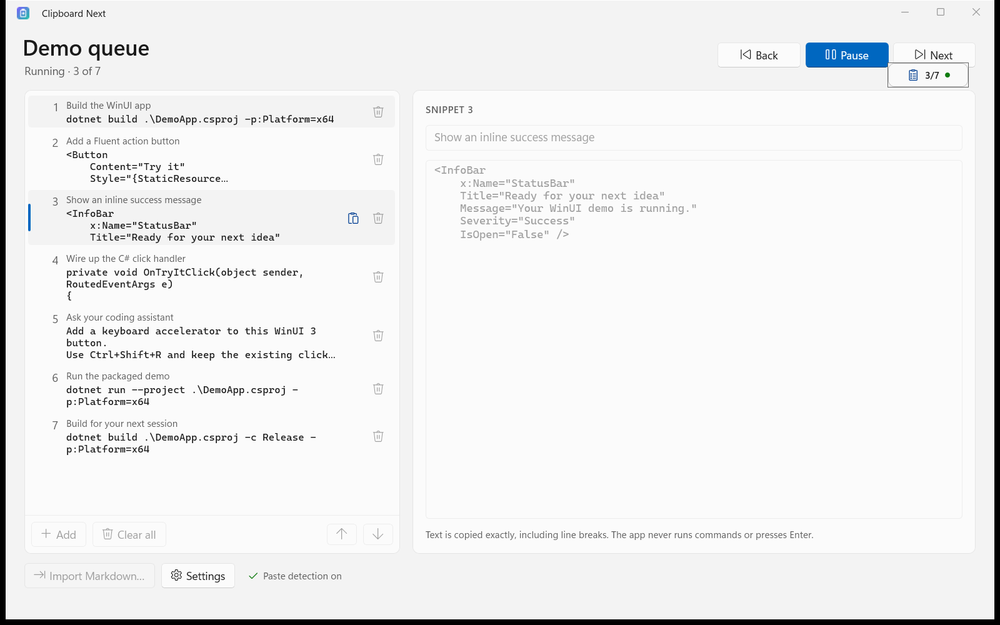

# Clipboard Next for Windows - Microsoft Store Listing

The source of truth for the Microsoft Store listing and the first submission of the Windows app. Clipboard Next for Windows is distributed **only** through the Microsoft Store.

## App identity

| Field | Value |
| --- | --- |
| Product name | Clipboard Next |
| Package identity name | `23875RefractoredLLC.ClipboardNext` *(expected; confirm below)* |
| Publisher | `CN=995C4AD9-3B22-4B61-B30F-3EAB23CDAEAE` |
| Publisher display name | Refractored LLC |
| Primary category | Developer tools |
| Secondary category | Productivity |
| Pricing | Free, no in-app purchases |
| Privacy policy | https://clipboardnext.com/privacy.html |
| Website | https://clipboardnext.com/ |
| Support URL | https://github.com/jamesmontemagno/clipboard-next/issues |
| Copyright | Copyright (c) 2026 Refractored LLC |

> **Confirm the identity before the first build you submit.** The values in
> `windows/src/ClipboardNext.App/Package.appxmanifest` were written before the name was reserved:
> the publisher is the Refractored LLC account's, and the identity name follows the pattern
> Partner Center used for Tiny Clips. After reserving **Clipboard Next**, open
> **Product management → Product identity** and copy `Package/Identity/Name`,
> `Package/Identity/Publisher`, and `Package/Properties/PublisherDisplayName` into the manifest if
> they differ. A package whose identity does not match is rejected at upload.

## en-US listing copy

### Short description

Stay in your demo. Queue commands, code, and prompts, then paste them in order without switching back to your notes.

### Description

Your next command. Already on your clipboard.

Keep your attention on the audience, not your notes. Clipboard Next lines up the commands, code snippets, and AI prompts for your live demo, talk, tutorial, or screencast. Press Start, paste your first snippet, and keep moving. With paste detection turned on, the next snippet is copied automatically after each paste.

Build your demo once

Give snippets memorable titles, edit multiline code, and arrange everything in the order you want to present. Import your existing Markdown presenter notes instead of copying each command by hand. Preview the snippets before importing, keep whole code blocks together, and choose whether to include blockquoted prompts. Append to your queue or replace it when you are ready.

Present without the back-and-forth

Turn on optional Ctrl+V paste detection and choose how long to wait before the next snippet is copied. Enable Ctrl+Shift+V and Shift+Insert detection when your terminal needs them. A small, draggable, always-on-top badge shows your place in the demo and flashes when a paste is detected, without taking keyboard focus.

Stay in control

Pause, resume, go back, skip ahead, or start from a selected snippet. Keep the editor open while preparing, then close it and use the notification-area controls while presenting. Manual Next and Back work without paste detection. If another app changes the clipboard's text, the queue pauses instead of overwriting what you copied.

Your demo stays yours

No account. No ads. No telemetry. No cloud sync. Your queue and preferences stay on your device, and the app makes no network connections. Snippets are copied as plain text; Clipboard Next never runs commands or presses Enter for you.

Built with native WinUI 3 for Windows 11, with x64 and ARM64 support and optional start with Windows. Free and open source.

### Product features

- Queue commands, multiline code, and AI prompts with optional titles and easy reordering.
- Import Markdown notes with a snippet preview, optional prompts, and whole-block or line-by-line code import.
- Automatically copy the next snippet after Ctrl+V, with an adjustable 0.10-3.00 second delay; paste detection is optional.
- Enable Ctrl+Shift+V and Shift+Insert detection for terminals, or advance manually without monitoring the keyboard.
- Track your place with a draggable, always-on-top badge that never takes keyboard focus.
- Pause, resume, go back, skip ahead, or start from a selected snippet using the editor or notification-area controls.
- Protect unexpected copies: the queue pauses when another app changes the clipboard's text.
- Work locally with no account, ads, network connections, cloud sync, or telemetry.
- Native Windows 11 app for x64 and ARM64, with optional start with Windows.

### Search terms

Enter these as **seven separate search terms**, not one comma-separated term:

- clipboard queue
- live coding
- demo presenter
- code snippets
- markdown import
- presentation tools
- AI prompts

### What's new in this version

First Windows release: prepare commands, code, and prompts in a native WinUI 3 demo queue. Import Markdown notes, advance as you paste, and follow your progress with a floating badge. Your queue stays on your device.

Replace this text with the user-visible changes for subsequent releases.

### System requirements and listing selections

- Windows 11 version 21H2 (build 22000) or later; desktop PCs, x64 and ARM64.
- No account, subscription, additional hardware, or developer tools required to use Clipboard Next. Developer tools are needed only to run the example WinUI commands.
- Select English (United States), Free, no in-app purchases, and the categories above. Complete market availability and the IARC questionnaire in Partner Center; do not infer an assigned rating from this document.
- Do not select Windows 10, Xbox, or HoloLens support. Do not claim accessibility certification or pen/touch optimization without completing the relevant validation.

## Screenshot set

The three **1600 x 1000 PNGs** in [`store-assets/`](store-assets/) are real captures of the locally registered Windows app, using WinUI demo examples and the same light theme. They are not mockups and were not captured from a Store-certified release. Re-capture from the release candidate whenever the UI changes before submission.

Upload these under **Store listings > en-US > Screenshots > Desktop**, in this order. Paste the caption into Partner Center's caption field, not onto the image.

| File | Feature | Caption (under 200 characters) |
| --- | --- | --- |
| [`01-demo-queue.png`](store-assets/01-demo-queue.png) | Prepare commands, code, and prompts | Build your demo once. Title, edit, and reorder commands, multiline code, and AI prompts before you present. |
| [`02-markdown-import.png`](store-assets/02-markdown-import.png) | Import presenter notes with a preview | Turn Markdown notes into your next demo. Preview code blocks, keep multiline snippets intact, and choose which prompts to include. |
| [`03-presenting.png`](store-assets/03-presenting.png) | Running queue, transport controls, and floating badge at 3/7 | Stay in the flow. Paste in order, keep your place with the floating badge, and pause, go back, or skip ahead whenever you need. |

See [`store-assets/README.md`](store-assets/README.md) for the capture command, safe sample content, and restoration behavior. Never commit screenshots containing personal data.

Microsoft requires desktop screenshots of at least **1366 x 768**, PNG, at most **50 MB each**. Its [image guidance](https://learn.microsoft.com/windows/apps/publish/publish-your-app/msix/screenshots-and-images) recommends no additional logos, icons, or marketing messages. These are screenshot-slot assets, not the optional text-free Super hero art. Three screenshots meet the required minimum of one; Microsoft recommends a larger set, but this set intentionally stays at three.

## Store assets

The package logos are generated into `windows/src/ClipboardNext.App/Assets/` by `windows/tools/generate-icons.py`. Upload the Store-logo variants Partner Center asks for and check them on light and dark backgrounds.

### Optional promotional hero

Upload [`super-hero-1920x1080.png`](store-assets/super-hero-1920x1080.png) under **Trailers and additional assets > Windows 10 or Windows 11 and Xbox image > 16:9 Super hero art**, not under Desktop screenshots. This text-free, website-inspired illustration uses a violet clipboard, queued sheets, and a mint next-sheet arrow. It is promotional artwork, not a screenshot; the original three Desktop captures above are unchanged.

The file is **1920 x 1080**, RGB PNG, with no product title, text, app UI, or device imagery. Review the Store's cropped previews before submitting. Providing hero artwork does not change supported platforms or guarantee a featured placement.

### Marketing screenshot compositions

The three **1920 x 1200** PNGs in [`store-assets/marketing/`](store-assets/marketing/) add website-style headlines and benefit copy around the real Windows captures. Use them as separate promotional compositions; retain the clean originals for Desktop screenshot uploads. They contain text and app UI, so they are not suitable for the Super hero art field either.

See the [asset instructions](store-assets/README.md#marketing-screenshot-compositions) for the individual images and the repeatable Pillow generator.

## Compliance answers

### Privacy

- Data collection: none. No account, advertising ID, analytics, or telemetry. The app makes no network connections.
- The queue and preferences are stored only on the device, in the app's own storage, and are removed on uninstall.
- Keyboard: paste detection is optional and off until the user turns it on. It recognizes the paste shortcut and nothing else; no keystroke is recorded, stored, transmitted, changed, or blocked.
- Clipboard: the app writes the user's own queued text to the clipboard. It reads the clipboard's text only to compare it with the current snippet, in memory.

Recheck these statements whenever network, account, analytics, or crash-reporting behavior changes, and keep https://clipboardnext.com/privacy.html in step.

### Capability justification

**runFullTrust:** Clipboard Next is a packaged desktop (WinUI 3) app. Full trust is required to show an icon in the notification area, to place the user's queued text on the clipboard, and, only after the user turns on paste detection, to install a listen-only low-level keyboard hook that recognizes the paste shortcut (Ctrl+V, and Ctrl+Shift+V and Shift+Insert if the user opts in) so the next queued snippet can be copied. The hook examines keys only while a queue is running, never blocks or modifies input, and nothing typed is recorded or leaves the device.

No other capabilities are declared.

### Notes for certification

- The app lives in the notification area (system tray). A normal launch also opens the editor window; closing that window leaves the app running in the tray. Use the tray icon's popup and its Exit button to quit.
- No account or sign-in is needed, and nothing is purchased in the app.
- To test: in the editor choose **Add** and type a short line of text, add two more, choose **Turn on paste detection**, then **Start**. Paste (Ctrl+V) into Notepad three times: each paste produces the next snippet. **Next** and **Back** work without paste detection.
- Paste detection uses a listen-only keyboard hook, described above and in the privacy policy. It is off by default.
- "Start with Windows" is off by default and is controlled by the user in Settings.

### Age rating

Complete the IARC questionnaire truthfully. The app has no user-generated public content, advertising, purchases, gambling, mature content, or web browsing.

## First submission and CI/CD setup

1. **Reserve the name** *Clipboard Next* in Partner Center and confirm the identity as described above.
2. **Verify on Windows.** Build and run the app on a Windows 11 machine and walk through the checks in [`windows/README.md`](../README.md#what-still-needs-a-windows-machine).
3. **Produce the first upload.** Push the release tag (for example `v1.0.0-windows`). The **Windows Store Publish** workflow's package job builds and verifies the upload. Its later jobs cannot submit anything yet: without the secrets from step 5 they stop at their configuration check. Download the `windows-store-package` artifact from that run. Or build the upload locally as shown in [`windows/packaging/README.md`](../packaging/README.md).
4. **Submit the first version by hand** in Partner Center: complete the listing, privacy, capability, age-rating, and pricing sections, upload the `.msixupload`, and submit for certification. The Microsoft Store Developer CLI can only update a product that is already live.
5. **Connect the workflow** once the product is live:
	  - Follow the exact secret names, portal locations, GitHub scopes, and validation steps in [`partner-center-setup.md`](partner-center-setup.md). There are **four environment secrets** and **two repository variables**; do not substitute package IDs for Store or Entra IDs.
6. **Release from then on** by pushing a tag like `v1.0.1-windows`. The workflow packages the upload, pauses for approval to submit it to `Internal Testing`, and requires a second approval before submitting that same verified upload to the public listing. Between the two approvals, install the flight as a tester and run the release checks. Submission is not certification: the Store still reviews each update.

Tags have three parts (`v1.2.3-windows`) and become package version `1.2.3.0`; the Store reserves the fourth part. Each release needs a higher version than the last. Windows tags are independent of the macOS `v*-mac` tags.

The workflow publishes **packages**, not this Markdown, screenshots, captions, or listing fields. Enter this copy and upload the images in Partner Center for the first submission; update the portal listing deliberately for later releases. Do not manually edit an API-created draft while CI is using it.
